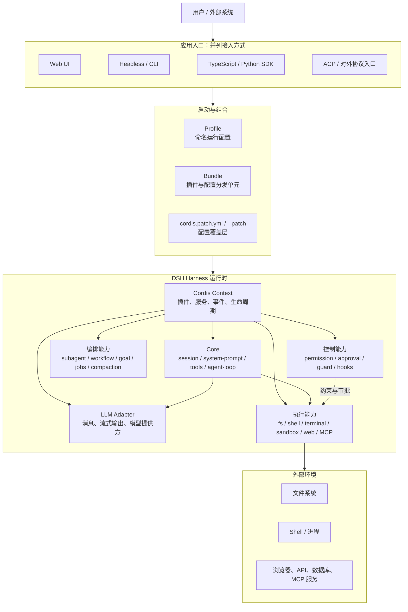
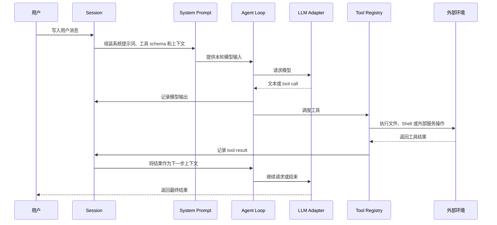
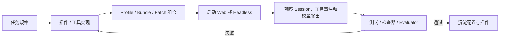
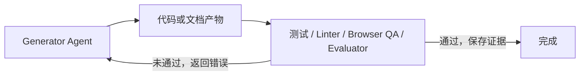

# 一、DSH 是什么

## 1.1 基本定义

**DSH（DeepSeek Harness）** 是 DeepSeek AI 开源的 Agent Harness。它负责把大模型接入文件系统、Shell、工具、会话、上下文、权限和应用入口，让模型能够在真实环境里持续执行任务。

可以用下面这个公式理解它：

```text
Agent = Model + Harness
```

- **Model** 负责理解、推理、规划和生成。
- **Harness** 负责提供上下文、工具、执行循环、状态记录、权限控制和反馈回路。
- **DSH** 主要解决 Harness 这一层的问题。

DSH 不是一个大模型，也不是单纯的模型 API SDK。它可以接入模型适配器，由运行时负责组织模型请求、工具调用和后续执行。

## 1.2 它和 Claude Code、LangChain 的关系

| 对象 | 主要定位 | 开源范围 | 更适合学习什么 |
|--|--|--|--|
| DSH | 可编程的 Agent Harness / 运行时 | 运行时、插件、配置和扩展机制较完整 | Agent 如何运行、扩展和组合 |
| Claude Code | 面向开发者的完整 Coding Agent 产品 | 产品实现不是完全开源 | 成熟 Coding Agent 的使用方式 |
| LangChain / LangGraph | LLM 应用和 Agent 编排框架 | 框架与生态开源 | 快速搭建应用、工作流和图式编排 |
| Claude Agent SDK | Agent 运行时原语和 SDK | 部分运行时能力开源 | 在 SDK 上构造自己的 Agent |

DSH 和 LangChain 不属于上下游关系。它们都可以作为 Agent 应用的基础设施，但抽象重点不同：LangChain 更偏应用开发和生态集成，DSH 更偏 Harness 运行时和可替换的底层能力。

## 1.3 DSH 当前状态

官方仓库目前将 DSH 标记为 **developer preview**，接口仍在快速迭代，可能出现兼容性破坏。学习和实验时应以官方仓库当前版本为准，生产依赖需要单独评估版本稳定性。

官方仓库采用 MIT 许可证，同时要求使用者阅读项目安全说明。DSH 运行时拥有文件、Shell 和外部服务等能力时，应结合权限、沙箱和工作区隔离使用。

官方入口：

- GitHub：https://github.com/deepseek-ai/deepseek-harness
- 文档：https://deepseek-harness.github.io/deepseek-harness/
- 运行 Web UI：`npx @deepseek-ai/dsh web`

---

# 二、总体架构

## 2.1 架构总览

DSH 的核心架构可以概括为：**Cordis 插件内核 + Profile / Bundle 配置组合 + Agent 核心服务 + 工具与执行能力 + 多种应用入口**。



这张图需要抓住三个关系：

1. **入口彼此并列，不是上下层调用链**。Web UI、Headless / CLI、SDK 和 ACP 是不同的接入方式，图中横向排列不表示执行顺序，底层可以共享同一套 Harness 组件。CLI 也可以用于启动 Web 等运行形态，这里按接入方式归类，不表示 Web 必须经过 Headless。
2. **配置组合不等于业务逻辑**。Profile、Bundle 和 Patch 负责选择、替换和叠加插件。
3. **一切皆插件**。不只是工具，模型适配器、Session、System Prompt、Agent Loop、权限控制，乃至 Web / Headless / SDK / ACP 这些应用入口本身，都是通过 Cordis 注册、组合和替换的插件。DSH 的运行时不是一套写死的程序，而是一棵由配置生成的插件树。

## 2.2 Cordis：DSH 的基础实现框架

Cordis 是 DSH 内置的插件框架。它的核心对象是一个共享的 `Context`。插件向 Context 注册服务、事件监听器和可撤销的副作用，其他插件通过服务键和事件与它们协作。

可以把 Cordis 的关键概念理解为：

| 概念 | 作用 | 在 DSH 中的意义 |
|--|--|--|
| Context | 服务和插件运行的共享环境 | 让能力通过 `ctx.xxx` 暴露 |
| Plugin | 可加载、可卸载的能力单元 | 工具、模型、会话和 Agent Loop 都能插件化 |
| Service | 插件提供的稳定能力 | 例如 `ctx.tools`、`ctx.llm`、`ctx.sessions` |
| Event | 插件之间的协作接口 | 观察、修改或拦截运行过程 |
| `inject` | 声明服务依赖 | 服务不存在时，插件不会提前运行 |
| Effect | 可撤销的注册行为 | 卸载插件时自动清理注册和监听 |
| Profile | 一组命名的运行配置 | 决定一次运行加载哪些 Bundle |
| Bundle | 插件和配置的分发单元 | 为 Profile 提供可组合的能力集合 |
| Patch | 对配置树进行插入或替换 | 在不改核心代码的情况下定制运行时 |

### 插件的基本形态

Cordis 插件可以是带有 `apply` 方法的对象、普通函数，也可以是 `Service` 子类。一个最小插件的思想如下：

```ts
import type { Context } from '@deepseek-ai/cordis'

export const name = 'hello-plugin'

export function apply(ctx: Context) {
  console.log('plugin mounted')
}
```

插件文件本身不负责启动整个应用。它声明自己提供什么能力，实际加载哪些插件由配置文件、Profile 或 Patch 决定。

### 服务依赖和生命周期

插件通过 `inject` 声明依赖：

```ts
export const name = 'tool-observer'
export const inject = ['tools']

export function apply(ctx: Context) {
  ctx.on('tools/result', (_execution, result) => {
    console.log(result)
  })
}
```

这里的含义是：

- `tool-observer` 依赖 `tools` 服务。
- Cordis 等待工具服务可用后再挂载它。
- `ctx.on()` 注册的监听器属于当前插件的生命周期。
- 插件卸载时，相关监听会被撤销。

这种方式把插件之间的依赖从“手动安排启动顺序”变成了“声明需要哪些服务”。

### 事件语义

Cordis 事件不只是简单的发布订阅。根据场景可以使用不同的调度方式：

- `emit` 用于普通事件通知。
- `parallel` 用于可以并行处理的监听器。
- `serial` 用于需要顺序执行的监听器。
- `bail` 用于遇到第一个决定性结果就停止。
- `waterfall` 类似可包装的中间件，监听器可以修改输入、调用 `next()`，或者直接截断后续流程。

这使 DSH 可以在工具执行、模型流、Agent 决策和权限检查等位置插入插件，而不用直接修改主循环。

## 2.3 Profile、Bundle 和 Patch

一次 DSH 运行不是固定写死的一套组件，而是由多层配置组合得到的插件树。

```text
Profile
  ├── Bundle 1
  ├── Bundle 2
  ├── 用户 cordis.patch.yml
  ├── Harness home 中的 patch
  └── 命令行 --patch 覆盖
```

大致流程如下：

1. 选择 Profile，例如 `web`、`headless`、`sdk` 或 `acp`。
2. Profile 声明要加载的 Bundle。
3. Bundle 提供插件配置和需要挂载的代码。
4. 用户 Patch 可以插入新插件或替换已有配置行。
5. 命令行 `--patch` 可以在本次运行中临时覆盖配置。
6. Cordis Loader 根据最终配置树挂载插件。

可以使用下面的命令查看实际启动的配置树：

```bash
dsh --profile web --dump-config
```

这体现了 DSH 的一个重要设计：**定制运行时主要通过配置和插件完成，而不是直接修改核心源码**。

---

# 三、DSH 的基础实现框架

## 3.1 从一次用户任务看执行链路

用户发送一个任务后，DSH 的典型执行链路可以抽象成：



一次“调用模型并处理工具调用”的过程可以看成一个 **Step**，多个 Step 组成一个 **Turn**。Session 记录整个过程，使工具结果、失败信息和后续修正能够成为下一步的事实依据。

## 3.2 Core：核心服务

官方架构文档把核心能力拆成多个可以替换的服务：

| Core 包 | 主要职责 | 典型服务或接口 |
|--|--|--|
| `core/session` | 追加式会话事件日志和内存存储 | `ctx.sessions` |
| `core/system-prompt` | 组装提示词区块和工具 schema | `ctx.systemPrompt` |
| `core/tools` | 工具注册、作用域和受保护执行管线 | `ctx.tools` |
| `core/agent` | Agent 接口、注册表和 Agent 事件 | `ctx.agents` |
| `core/agent-loop` | 驱动模型和工具持续交互 | `ctx.agentLoop` |
| `core/scope` | 每个 Agent 的局部注册作用域 | 库能力 |
| `llm/llm` | 消息、流式输出和 LLM 适配器接缝 | `ctx.llm` |

### Session

Session 是 Agent 的事实记录层。它通常采用 append-only 事件日志：新消息、模型输出、工具调用、工具结果和扩展事件持续追加，不通过随意覆盖历史来维护状态。

它带来几项能力：

- 从历史事件派生下一次模型请求。
- 追踪 Agent 做过哪些操作。
- 在长任务中进行回放、检索或分叉。
- 为 compaction 和 goal 等能力提供统一数据来源。
- 将“测试失败”“工具报错”等环境反馈保留给后续步骤。

Session 记录的是运行事实。它和长期用户记忆、项目规则文件属于不同层次，不能互相替代。

### System Prompt

`system-prompt` 负责管理发送给模型的系统提示词区块和工具定义。它可以把来自项目说明、Skill、工具注册表和运行状态的信息组合到模型输入中。

这一层与上下文工程直接相关：

- 固定规则应保持高信噪比。
- 工具 schema 要描述清楚参数、限制和返回值。
- 任务相关的 Skill 和检索内容应按需注入。
- 长会话需要配合 compaction、reset 或外部交接文件管理上下文预算。

### Tools

工具服务负责工具注册和执行管线。工具一般需要声明：

- 名称和描述
- 参数 schema
- 参数校验
- 执行函数
- 结果 schema
- 面向模型或用户的结果呈现方式

一个工具从模型请求进入，到参数校验、执行、结果记录和事件通知，通常都经过统一的 tools pipeline。插件可以监听工具结果做日志、计量、权限检查或二次处理。

### Agent Loop

Agent Loop 是 DSH 的执行心脏，负责在模型和工具之间推进任务：

```text
读取上下文
  → 请求模型
  → 判断是否产生 tool call
  → 执行工具
  → 记录结果
  → 将结果加入下一步上下文
  → 继续或结束
```

Agent Loop 还要处理停止条件、并发工具、错误反馈、审批和扩展插件。模型输出“看起来完成”不等于任务完成，实际的完成判断通常还需要测试、检查器或独立评估器。

## 3.3 LLM Adapter：模型适配器

DSH 把消息和流式输出抽象成 LLM 层，并通过适配器接入具体模型提供方。这样 Agent Loop、Session 和工具层可以尽量与某个模型 API 解耦。

模型适配器主要处理：

- 输入消息转换
- 工具 schema 转换
- 流式响应
- tool call 与 tool result 的映射
- token 和用量统计
- 不同模型提供方的请求差异

因此，换模型通常属于替换或配置 LLM adapter 的问题，不需要重写整个 Agent Loop。

## 3.4 Tools、FS、Shell 和外部环境

DSH 的工具层负责把模型的决策落到外部环境。常见能力可以分为几类：

| 能力 | 作用 | 上下文工程意义 |
|--|--|--|
| 文件系统 | 读写文件、目录和附件 | 主动采购代码与文档上下文 |
| LSP | 跳转定义、查找引用、获取符号信息 | 以语义方式缩小检索范围 |
| Shell / subprocess | 执行命令和进程 | 运行测试、构建和诊断命令 |
| Terminal / code runtime | 提供交互式执行环境 | 支持需要持续状态的任务 |
| Sandbox | 隔离副作用 | 限制文件、命令和网络影响范围 |
| Web / MCP | 访问网页和外部工具 | 连接外部知识与服务 |
| Skill | 动态加载结构化能力 | 按需注入工作流和领域约束 |

文件系统检索不是单纯的工具调用。对 Agent 来说，`Glob`、`Grep`、`Read` 和 `LSP` 也构成了“获取上下文”的过程。

## 3.5 Sub-Agent 和 Workflow

DSH 将长任务组织能力拆成不同层次：

- **Sub-Agent**：把一个子任务委派给独立 Agent，使用独立上下文，最终回传结论或产物。
- **Workflow**：按程序化步骤编排多个任务、Agent 或工具。
- **Goal**：保存当前目标和推进状态，避免长会话中丢失任务方向。
- **Todo / Plan**：把复杂任务显式拆成可追踪的步骤。
- **Jobs / Schedule**：支持后台任务或定时执行。
- **Compaction**：压缩旧的会话内容，回收上下文预算。
- **Guard**：在执行关键操作前提供约束和保护。

Sub-Agent 解决的是上下文隔离和任务分工，Workflow 解决的是执行顺序和编排。二者不要混为一个概念。

## 3.6 Context、Memory 和 Compaction

DSH 中需要区分三种东西：

| 名称 | 主要载体 | 作用 |
|--|--|--|
| Context | 当前发送给模型的输入 | 支撑本轮决策 |
| Session | append-only 运行事件 | 保存当前任务的过程事实 |
| Memory | 跨会话的外部化信息 | 保存稳定经验、偏好或项目知识 |

当上下文接近窗口上限时，可以使用：

- **Compaction**：摘要旧消息和工具结果。
- **Context reset**：清空当前上下文，通过进度文件、git、任务清单等重新接力。
- **Spill**：把超长内容放到外部存储，当前上下文保留指针或摘要。

长任务中，压缩并不能自动解决“哪些信息值得保留”。可靠的交接通常还需要明确的目标、进度文件、可验证产物和测试结果。

---

# 四、从零实现一个 DSH 插件

## 4.1 最小插件的开发思路

学习 DSH 不需要一开始就阅读整个仓库，可以先实现一个只做一件事的插件：

```text
声明插件
  → 声明服务依赖
  → 注册工具或事件
  → 通过 Profile / Patch 挂载
  → 运行真实工具管线
  → 观察结果和生命周期
```

## 4.2 实现一个可被模型调用的工具

官方 Cordis 教程使用了 `greet-tool` 作为示例。它通过 `defineTool` 定义参数和输出，再把工具注册到 `ctx.tools`：

```ts
import type { Context } from '@deepseek-ai/cordis'
import { defineTool } from '@deepseek-ai/dsh-tools'

export const name = 'greet-tool'
export const inject = ['tools']

export function apply(ctx: Context) {
  ctx.tools.register(defineTool({
    name: 'greet',
    description: 'Greet the named person.',
    parameters: {
      name: {
        type: 'string',
        required: true,
        description: 'Who to greet',
      },
    },
    output: {
      schema: { type: 'string' },
      render: (_args, value) => [{ type: 'text', text: value }],
    },
    async execute(args) {
      return `Hello, ${args.name}`
    },
  }))
}
```

这个例子展示了几个关键点：

1. `inject: ['tools']` 表示插件依赖工具服务。
2. `ctx.tools.register()` 把工具接入统一工具注册表。
3. `parameters` 会生成给模型看的参数 schema，并用于校验模型传入的参数。
4. `execute` 只负责执行工具逻辑。
5. `output.schema` 和 `output.render` 分别描述规范化结果和展示结果。
6. 工具注册属于当前插件的生命周期，插件卸载时可以撤销。

## 4.3 监听工具结果

工具和观察器可以拆成两个插件。观察器只监听工具结果，不需要修改工具本身：

```ts
import type { Context } from '@deepseek-ai/cordis'
import type {} from '@deepseek-ai/dsh-tools'

export const name = 'tool-logger'
export const inject = ['tools']

export function apply(ctx: Context) {
  ctx.on('tools/result', (execution, result) => {
    console.log(`[tool-logger] ${execution.name}`, result)
  })
}
```

这个模式可以扩展为：

- 工具调用日志
- token、延迟和费用统计
- 敏感工具审批
- 工具错误监控
- 结果脱敏和压缩
- 统一审计记录

## 4.4 通过 Patch 组合插件

插件写好后，需要通过配置把它挂载到运行时。官方教程的核心思路是使用一个 Patch overlay，把自定义插件插入已有 Profile，而不是修改 DSH 核心包。

```text
基础 Profile
  + 官方 Bundle
  + 用户 cordis.patch.yml
  + 本次 --patch
  = 最终插件树
```

查看配置树：

```bash
dsh --profile web --dump-config
```

开发阶段可以使用源码仓库的构建和开发命令。具体命令应以当前版本的官方 development guide 为准，因为 developer preview 的目录和脚本可能变化。

## 4.5 一个最小的应用开发闭环



---

# 五、应用与案例参考

## 5.1 官方教程案例：Greet Tool

`greet-tool` 是官方 Cordis 教程中用于理解 DSH 工具管线的最小例子。它不依赖模型调用也能验证工具注册和执行，适合第一次学习时使用。

建议观察：

- 工具如何进入 `ctx.tools`。
- 参数 schema 如何被定义和校验。
- 工具结果如何经过 `tools/result` 事件。
- 插件卸载后注册是否撤销。
- 如何用 Patch 把插件挂进现有 Profile。

它的价值不在于问候工具本身，而在于展示“插件声明 → 服务依赖 → 工具注册 → 真实执行管线”的完整闭环。

## 5.2 Coding Agent

DSH 最自然的应用方向是 Coding Agent：

```text
用户需求
  → 读取 AGENTS.md / 项目文档
  → 检索代码和调用关系
  → 修改文件
  → 运行测试和 linter
  → 根据失败结果继续修正
  → 输出变更说明和验证证据
```

对应的 DSH 能力包括：

- `fs`、`lsp`：检索代码和项目文档。
- `shell`、`terminal`：运行测试、构建和诊断命令。
- `session`：保存工具调用和反馈。
- `agent-loop`：持续推进多步任务。
- `permission`、`guard`、`sandbox`：限制高风险操作。
- `subagent`：并行调研、测试或代码审查。
- `compaction`、`goal`：支持长时程任务。

Coding Agent 的关键不是让模型一次生成完代码，而是让它拥有“检索 → 修改 → 验证 → 修正”的闭环。

## 5.3 仓库调研和代码分析 Agent

可以把 DSH 配成一个只读调研 Agent：

- 只开放 Glob、Grep、Read、LSP 等读取工具。
- 禁止写文件和执行任意 Shell。
- 让 Sub-Agent 分别分析架构、入口、数据流和测试覆盖。
- 主 Agent 汇总结构化结论。

这个场景适合用来学习上下文工程，因为它能清楚观察：

- Agent 如何选择检索路径。
- 子 Agent 如何隔离中间过程。
- 哪些检索结果应该回传主 Agent。
- 如何控制上下文规模和重复读取。

## 5.4 自动化 QA 和验证 Agent

DSH 可以把测试、linter、浏览器检查器或领域检查器接入工具和事件管线，形成独立验证环：



这里应尽量使用外部、可执行的验证条件。单靠生成 Agent 自己说“已经完成”，无法证明产物真的满足要求。

## 5.5 领域工具 Agent

通过自定义插件，DSH 可以接入领域工具，例如：

- 数据库查询和数据质量检查。
- 内部知识库或文档检索。
- 浏览器自动化和网页操作。
- 企业内部 API 和工单系统。
- 仿真环境、代码运行环境和实验工具。
- 机器人或具身智能系统的状态读取与动作接口。

这类应用的核心工作是把外部能力设计成清晰、可校验、可授权的工具 schema，并为工具结果建立可追踪的事件记录。

## 5.6 多 Agent 协作

一个较完整的多 Agent 系统可以拆成：

```text
Planner Agent       拆解目标和任务依赖
      ↓
Research Agent      检索资料、代码和外部信息
      ↓
Worker Agent        执行具体修改或操作
      ↓
Evaluator Agent     独立检查产物
      ↓
Human Approval      对高风险操作进行审批
```

DSH 的 Sub-Agent、Workflow、Goal、Jobs 和 Guard 可以分别承担委派、编排、目标保持、后台任务和执行保护。实际系统仍需要自己定义任务边界、状态交接和验收条件。

## 5.7 DSH 适合和不适合的场景

| 场景 | 适配度 | 原因 |
|--|--|--|
| 学习 Agent Harness 原理 | 高 | 插件、事件、Session 和 Loop 都能观察和扩展 |
| 研究自定义工具和 Agent Runtime | 高 | 能替换模型、工具、循环和配置层 |
| Coding Agent 原型 | 高 | 文件、Shell、工具和验证回路容易组合 |
| 企业内部工作流实验 | 中 | 可接入内部工具，但需要自行补权限、审计和稳定性 |
| 生产级强稳定平台 | 需要谨慎 | 当前仍是 developer preview，接口可能变化 |
| 只想快速调用一个模型 API | 偏低 | DSH 的能力范围超出简单模型调用需求 |

---

# 六、学习和阅读路线

## 6.1 推荐顺序

1. 先读现有 [2.1 Harness Engineering 简介](./2.1%20Harness%20Enginerring简介.md)，理解 Model、Harness 和 Harness Engineering 的区别。
2. 再读 [2.1.1 上下文工程](./2.1.1%20基于DSH学习Harness——上下文工程.md)，理解 Session、个人上下文、项目上下文、检索、Skill、Sub-Agent 和 Compaction 的关系。
3. 阅读 DSH 官方 `README`，了解运行方式和项目状态。
4. 阅读官方 `docs/architecture.md`，建立 Profile、Bundle、Patch、Core package 的整体地图。
5. 阅读 `docs/cordis-primer.md`，理解 Context、Plugin、Service、Event、Effect 和依赖注入。
6. 运行官方 Cordis Tutorial 的第一个插件和 `greet-tool`。
7. 进入 `packages/core`，依次看 `session`、`system-prompt`、`tools`、`agent` 和 `agent-loop`。
8. 再看 `packages/subagent`、`workflow`、`goal`、`compaction` 和 `guard`。
9. 最后实现一个自己的只读检索工具、日志插件或验证插件。

## 6.2 源码阅读主线

```text
Cordis
  → Context / Plugin / Service / Event
  → Profile / Bundle / Patch
  → Session
  → System Prompt + Tools
  → LLM Adapter
  → Agent Loop
  → Sub-Agent / Workflow / Goal
  → 应用入口（Web / Headless / SDK / ACP）
```

读源码时不要从 UI 开始。先理解一次任务如何穿过 Session、Prompt、LLM、Tool 和 Loop，再回头看 Web 或 SDK 如何接入这些服务。

## 6.3 第一个练习项目

可以实现一个“仓库结构分析 Agent”：

1. 只开放文件列表、文本搜索和文件读取工具。
2. 禁止写文件、执行 Shell 和访问网络。
3. 让一个 Sub-Agent 分析目录结构。
4. 让另一个 Sub-Agent 分析入口和依赖关系。
5. 主 Agent 汇总结果并输出 Mermaid 架构图。
6. 用一个检查器验证引用的文件确实存在。
7. 记录 Session 和工具结果，观察上下文如何增长。

这个练习同时覆盖了 DSH 的核心概念：插件、工具 schema、文件检索、Sub-Agent、Session、上下文管理和验证反馈。

---

# 七、和现有 Harness 笔记的关系

| 笔记 | 关注点 | 本篇的关系 |
|--|--|--|
| `2.1 Harness Enginerring简介.md` | Harness 的方法论和模块地图 | 提供 DSH 的上位概念 |
| `2.1.1 基于DSH学习Harness——上下文工程.md` | 上下文预算、记忆、检索、Skill、Sub-Agent | 解释 DSH 中与上下文相关的部分 |
| `2.2 DSH 介绍.md` | DSH 的架构、基础实现和应用 | 本篇作为 DSH 总览 |
| `1.4 Agent Skills.md` | Skill 的结构和生命周期 | 解释 DSH 能力层中的 Skill |
| `OpenClaw与DSH.md` | 成品 Agent 与底层 Harness 的对照 | 补充 DSH 的产品定位比较 |

---

# 八、局限与事实边界

1. DSH 官方当前标记为 developer preview，API 和包结构可能发生兼容性破坏。
2. Profile、Bundle、Patch 和 Cordis 的准确字段、事件名和包路径应以当前官方仓库为准。
3. DSH 提供运行时和扩展机制，但具体项目仍需要自行设计 AGENTS.md、权限、验证器、交接文件和评估集。
4. “适合 Coding Agent、QA Agent 或领域工具 Agent”是基于其公开能力的应用方向，不等于官方已经提供对应的完整生产产品。
5. DSH 的安全能力不能替代应用层的权限治理、密钥管理、网络隔离和操作审计。

---

# 九、核心总结

1. **DSH 是 Agent Harness，不是模型。**它把模型、工具、上下文、会话和执行环境连接起来。
2. **DSH 的核心思想是「一切皆插件」。**用 Cordis 插件内核 + Profile / Bundle / Patch，把运行时组合成一棵可替换的插件树——工具、模型、会话、Loop 和入口都只是这棵树上的节点。
3. **DSH 的基础实现主线是 Session → System Prompt / Tools → LLM Adapter → Agent Loop。**
4. **Session 保存运行事实，Agent Loop 推进任务，Tools 连接外部环境，LLM Adapter 解耦模型提供方。**
5. **Sub-Agent 负责隔离委派，Workflow 负责程序化编排，Goal 和 Compaction 支撑长任务。**
6. **学习 DSH 的最佳方式是先做一个小插件，再顺着一次工具调用阅读整个执行链路。**
7. **当前最适合把 DSH 当作学习和实验型 Harness 使用，生产使用要考虑 developer preview 带来的兼容性问题。**

---

# 参考资料

1. DeepSeek AI，DeepSeek Harness 官方仓库：https://github.com/deepseek-ai/deepseek-harness
2. 官方架构文档：https://github.com/deepseek-ai/deepseek-harness/blob/master/docs/architecture.md
3. Cordis Primer：https://github.com/deepseek-ai/deepseek-harness/blob/master/docs/cordis-primer.md
4. Cordis Tutorial，第一个插件：https://github.com/deepseek-ai/deepseek-harness/blob/master/docs/cordis-tutorial/01-first-plugin.md
5. Cordis Tutorial，进入 Harness：https://github.com/deepseek-ai/deepseek-harness/blob/master/docs/cordis-tutorial/07-into-the-harness.md
6. DeepSeek Harness 中文教程：https://github.com/ht426/deepseek-harness-tutorial
7. 本项目笔记：[Harness Engineering 简介](./2.1%20Harness%20Enginerring简介.md)、[上下文工程](./2.1.1%20基于DSH学习Harness——上下文工程.md)
8. [B站教程：【全网最全】DeepSeek Harness超详细教程！50分钟吃透DSH，让SuperAgent给你干活！](https://www.bilibili.com/video/BV1REx46NEc4/?share_source=copy_web&vd_source=d8e828b07cd91969d106258b045aa1b7)

> DSH 的安装命令、Profile 名称、包路径和事件签名可能随版本变化。实际开发时，应优先以官方仓库当前版本的 README、architecture 文档和生成的 subsystem 文档为准。
